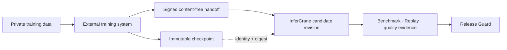

# Bring trained artifacts into the release path

InferCrane does not schedule training jobs. MLflow, Kubeflow, SkyPilot, a managed fine-tuning system,
or your existing pipeline owns data, execution, and checkpoint storage. The pipeline hands InferCrane
a signed immutable artifact identity for release qualification.



## Serve the model you trained

InferCrane serves what your training system produced, pinned to immutable identity, on GPUs in your
own account. Pick the path that matches where the checkpoint lives; the
[model artifacts](/features/model-artifacts) page has the provider details.

| Where it comes from | What InferCrane needs | How to serve it |
|---|---|---|
| Prime Intellect prime-rl, or any trainer that exports a Hugging Face model folder | `config.json`, tokenizer files, and safetensors weights | Push the folder to a private Hugging Face repository, save a read token with `infercrane secret create hf-token --sealed-from-env HF_TOKEN`, and deploy the repository with `--model-secret` |
| Tinker or another LoRA trainer | `adapter_config.json` and `adapter_model.safetensors` | Push the adapter to Hugging Face (private with a sealed token) or your bucket, check it with `infercrane models adapter-check` or import it with `--kind adapter`, and deploy the base model with `--adapter` |
| MLflow model registry | The registered model's files | Download them with `mlflow artifacts download`, and either push them to a private Hugging Face repository or, when the artifact store is S3 or GCS, run `infercrane models import` on the same files |
| Your own S3 or GCS bucket | The files and a local copy to hash | `infercrane models import s3://BUCKET/PREFIX --from DIR`, then deploy the location with `--model-revision` set to the digest it prints |

Weights in a bucket are read by your workers with their own cloud identity; InferCrane never reads
the bucket. A private Hugging Face token is delivered to the worker by the provider: a RunPod secret
in your own account, a Kubernetes `secretKeyRef`, or a Secrets Manager ARN. The same pinned model and
adapter reach every candidate of an [optimization run](/features/optimization).

The signed handoff below is separate: it records where an artifact came from. Serving does not need
it, and attaching it never promotes a revision.

## Create a signing key

Keep this key in the training system's secret manager:

```bash
infercrane training keygen --file training-handoff.key
```

The private key file is created with mode `0600` and is never uploaded to InferCrane.

## Sign immutable provenance

```bash
infercrane training sign coder-runtime REVISION_ID \
  --provider mlflow \
  --run run-2026-08-14-42 \
  --repository mlflow://registry/coder/42 \
  --immutable-revision 42 \
  --digest sha256:aaaaaaaaaaaaaaaaaaaaaaaaaaaaaaaaaaaaaaaaaaaaaaaaaaaaaaaaaaaaaaaa \
  --base-model meta-llama/Llama-3.1-8B-Instruct@IMMUTABLE_COMMIT \
  --method lora \
  --framework transformers \
  --framework-version 5.0.0 \
  --key training-handoff.key \
  --file coder-42.handoff.json
```

Use the checkpoint digest produced by your registry or artifact store. The handoff contains no
dataset rows, prompts, outputs, logs, credentials, or checkpoint bytes.

## Verify and attach

```bash
infercrane training verify coder-42.handoff.json
infercrane training attach coder-runtime coder-42.handoff.json
infercrane training list coder-runtime
```

Attachment fails closed when:

- the signature or payload was modified;
- the path deployment does not match the signed deployment;
- the revision belongs to another tenant or does not exist;
- the revision already references a different immutable artifact;
- the repository contains credentials, query parameters, or a mutable/unsafe location.

## Promotion remains separate

Artifact provenance is not evidence that a candidate should receive traffic. Continue with:

```bash
infercrane benchmark coder-runtime
infercrane replay coder-runtime --candidate REVISION_ID
infercrane evaluation attach coder-runtime --file quality-evidence.json
infercrane rollout inspect coder-runtime
```

Release Guard decides from compatible persisted policy and evidence. An external training system
never promotes a revision by merely attaching a checkpoint.

## Console workflow

Workload detail displays signed training lineage and accepts an already signed handoff JSON file.
Signing remains a CLI/CI operation so private training keys never enter browser code.
